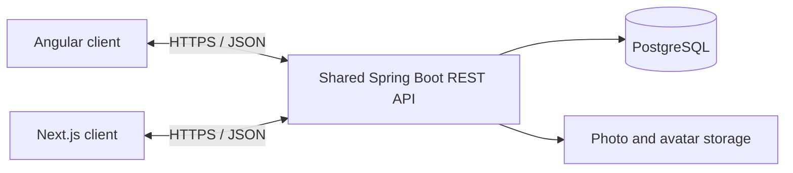

<div align="center">

# PhotoForum 📸

### One Java REST API, two frontend implementations

<p>
  
  
  
  
  
  
</p>

<p>
  
  
  
</p>

</div>

---

## Overview

PhotoForum is a full-stack photo-sharing application created to compare **Angular** and **Next.js** implementations under the same functional requirements.

Both clients communicate with one shared Java and Spring Boot REST API. This makes it possible to compare frontend structure and integration choices without changing the backend domain or API contract.

### Shared capabilities

- user registration and authentication
- access- and refresh-token workflows
- user profiles and avatars
- photo upload and storage
- public photo feed
- likes and favourites
- comments
- user-specific photo collections
- shared REST API contract
- separate development and production Docker environments

---

## Architecture



The backend remains the common comparison baseline. Both frontend applications implement equivalent user workflows against the same endpoints.

---

## Frontend comparison

The project provides a practical foundation for comparing two frontend approaches against the same backend.

| Area | Angular client | Next.js client |
|---|---|---|
| Application model | Framework-led client application | React-based Next.js application |
| Language | TypeScript | TypeScript |
| Routing | Angular routing implementation | Next.js routing implementation |
| API integration | Angular HTTP layer | Client-side integration with the shared API |
| Authentication | Shared token and cookie contract | Shared token and cookie contract |
| Functional scope | Equivalent PhotoForum workflows | Equivalent PhotoForum workflows |
| Backend dependency | Shared Spring Boot API | Shared Spring Boot API |

The table intentionally describes the project architecture without claiming that one framework is universally better. Detailed conclusions should be based on the actual implementation and team experience.

---

## Technology stack

| Area | Technologies |
|---|---|
| Backend | Java, Spring Boot, REST APIs |
| Angular client | Angular, TypeScript |
| Next.js client | Next.js, React, TypeScript |
| Persistence | PostgreSQL |
| Authentication | Access and refresh tokens stored in cookies |
| Media | Photo and avatar storage |
| Delivery | Docker, Docker Compose |
| Transport | HTTPS in the configured environment |

---

## API overview

The backend exposes endpoints for:

- login, registration, logout and token refresh
- authorisation checks
- photo upload and retrieval
- likes, comments and favourites
- user profile details
- user-specific photo collections
- avatar and media retrieval

Move detailed request and response examples to a dedicated file such as:

```text
documentation/api.md
```

Then keep this README focused on project value, architecture and setup.

---

## Running the project

### Frontend development environment

```bash
docker compose -f compose.frontend.dev.yaml up --build --force-recreate
```

### Frontend production environment

```bash
docker compose -f compose.frontend.yaml up --build --force-recreate
```

### Backend development environment

```bash
docker compose -f compose.backend.dev.yaml up --build --force-recreate
```

### Backend production environment

```bash
docker compose -f compose.backend.yaml up --build --force-recreate
```

The backend requires its Spring application configuration, database credentials, JWT values and media-storage path. The root environment file supplies PostgreSQL configuration.

---

## Project structure

```text
.
├── backend/
├── frontend - angular/
├── frontend - next.js/
├── documentation/
├── mockups/
├── certs/
├── compose.backend.dev.yaml
├── compose.backend.yaml
├── compose.frontend.dev.yaml
└── compose.frontend.yaml
```
